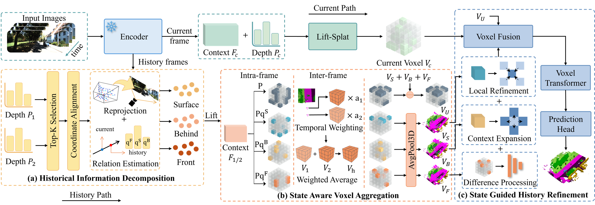
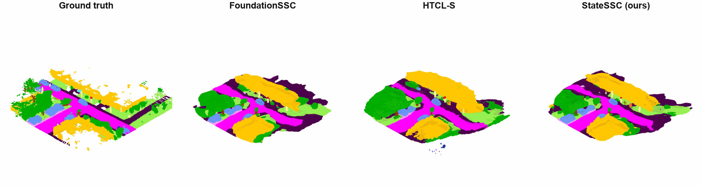
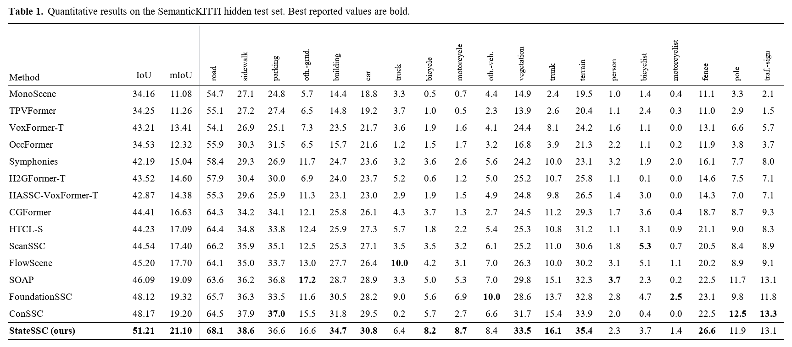
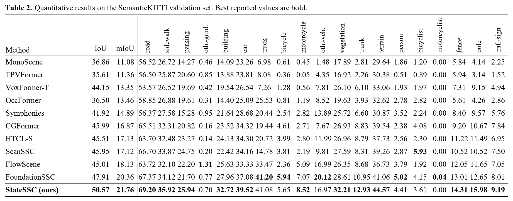
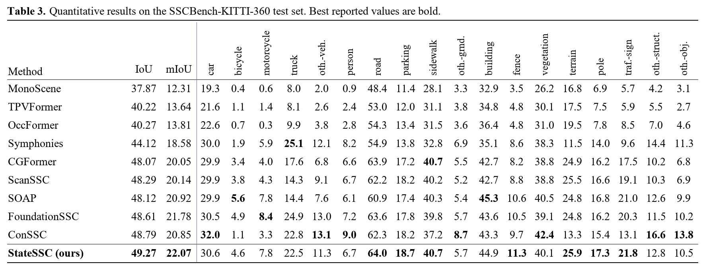

# StateSSC: Historical Three-State Decomposition for Temporal Semantic Scene Completion

## Abstract

Camera-based temporal semantic scene completion (SSC) uses historical observations to recover scene content missing from the current view. Although pose alignment establishes spatial correspondences across frames, historical candidate information can still exhibit different geometric relationships with the currently observed surface. Existing temporal methods often compress these candidates into a single representation, thereby obscuring their distinct roles in current-scene inference. To address this limitation, we propose a current-centric SSC framework for improving current-scene inference through more effective use of historical information. Specifically, it compares pose-aligned historical depth candidates with the current depth distribution and assigns each candidate to one of three geometric states based on its position relative to the current surface: *front*, *surface*, or *behind*. To preserve these states during voxelization, we design a State-Aware Voxel Aggregation (SAVA) module that performs intra-frame voxelization and inter-frame aggregation. We further introduce a State-Guided History Refinement (SGHR) module that refines historical voxel representations according to their states and fuses them with current-frame voxel representations for the final voxel representation. Experiments on SemanticKITTI and SSCBench-KITTI-360 demonstrate competitive geometric and semantic completion performance.

## Framework

The shared foundation encoder extracts context features and depth distributions from the current and historical images. The current image is lifted into a voxel representation. The historical path uses the fifth and tenth preceding frames and proceeds through three stages:

1. **Historical Information Decomposition (HID)** compares pose-aligned historical depth candidates with the current depth distribution and estimates their *front*, *surface*, and *behind* states.
2. **State-Aware Voxel Aggregation (SAVA)** retains the three states during within-frame voxelization and across-frame aggregation, while preserving historical information whose state cannot be determined from the current observation.
3. **State-Guided History Refinement (SGHR)** refines the state-specific historical voxels and fuses the reconstructed historical representation with the current voxel representation for SSC prediction.

At each image location, the method retains the four most probable historical depth candidates.

## Qualitative Results

The four-way comparison on SemanticKITTI sequence 08 shows the ground truth alongside FoundationSSC, HTCL-S, and StateSSC. In the illustrated scenes, StateSSC preserves the main road layout and roadside vehicles; fine vegetation remains less complete than the ground truth.

## Quantitative Results

### SemanticKITTI hidden test set

StateSSC achieves **51.21% IoU** and **21.10% mIoU** on the hidden test set. Strong class-wise results for road, building, vegetation, and terrain show its ability to recover extensive surfaces and scene structures.

### SemanticKITTI validation set

On the held-out sequence 08, StateSSC achieves **50.57% IoU** and **21.76% mIoU**. The close agreement with the hidden-test scores supports good generalization across SemanticKITTI sequences.

### SSCBench-KITTI-360 test set

StateSSC achieves **49.27% IoU** and **22.07% mIoU** on SSCBench-KITTI-360, with strong class-wise results for road, parking, terrain, fence, pole, and traffic sign. Its performance on a second benchmark supports the applicability of the temporal design across dataset settings. Across these evaluations, the structural results are consistent with preserving distinct surface-related historical information through state-aware aggregation and refinement.
